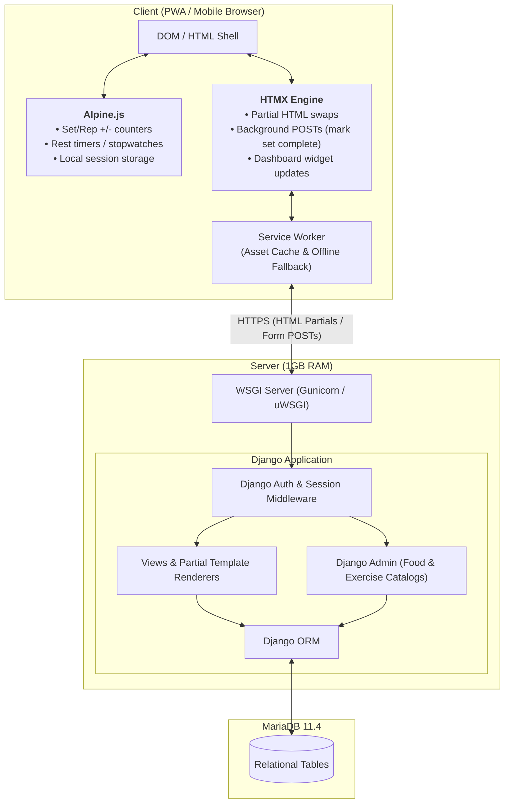
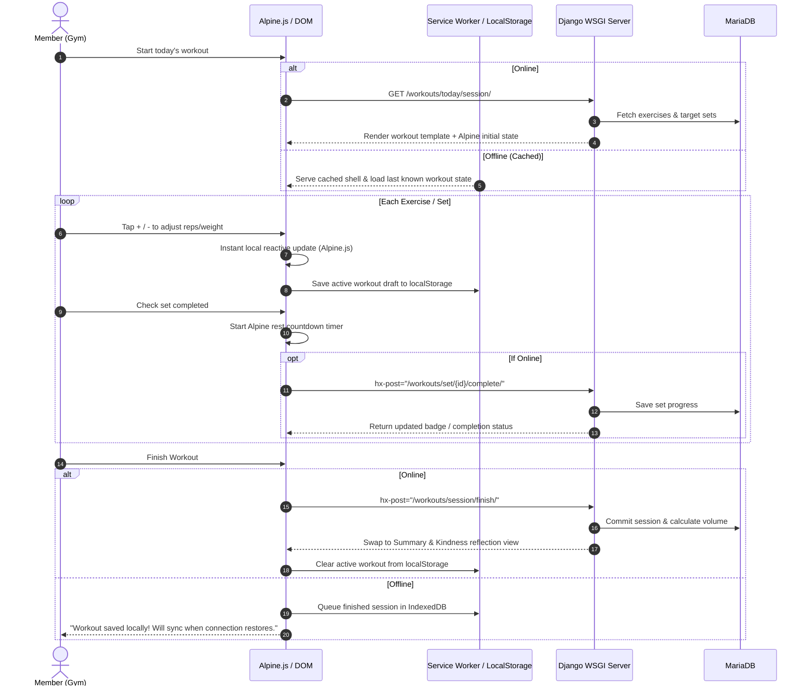

# Architecture

# Target

* Web App (PWA)
    - Mobile-first, installable to home screen
    - Offline-resilient workout logging for gym environments with poor connectivity

# Hosting

* Hardware:
    - CPU: 1 vCPU
    - RAM: 1GB
    - Storage: 2GB
    - Traffic per month: 50GB
* Software:
    - Python: 3.12.14
    - WSGI only (no async runtime required)
* Database:
    - MariaDB: 11.4.13


# Technology Stack & Rationale

| Layer | Technology | Rationale & Responsibility |
| :--- | :--- | :--- |
| **Backend & Core** | **Django 5.x** | Monolithic WSGI architecture. Idles under ~100MB RAM, perfectly matching the 1GB constraint. Handles routing, business logic, ORM, and migrations. |
| **Auth** | **Django Auth** | Battle-tested session-based authentication with HTTP-only secure cookies and native CSRF protection. User onboarding is invite-only via secure, time-limited cryptographic URL tokens. |
| **Admin Back-office** | **Django Admin** | Free, powerful management interface for curating exercise databases, plant-based food catalogs, and amino acid profiles. |
| **Database Driver** | **`mysqlclient`** | High-performance C-extension driver for MariaDB 11.4 with connection pooling. This might not work, and we might need to replace it with a Python driver due to the host not having the necessary build tools. |
| **Server Interactivity** | **HTMX** | Declarative AJAX swaps (completing exercises, updating schedules, dashboard widget refreshes) without full-page reloads. |
| **Client Interactivity** | **Alpine.js** | Lightweight (~15kb) client-side reactive state for immediate UI response: `+`/`-` set/rep counters, rest timers, and stopwatches. |
| **Styling** | **Tailwind CSS** | Mobile-first utility styling optimized for gym usability (large touch targets, high-contrast dark mode). |
| **PWA & Offline** | **Service Worker + Cache / IndexedDB** | App manifest for home-screen installation; Service Worker for static asset caching; `localStorage`/IndexedDB via Alpine for active workout resilience when offline. |


## Project Structure

```
grow/
├── config/          # Django project settings, URLs, WSGI
├── workouts/        # Workout plans, schedules, session logging
├── nutrition/       # Meal planning, food items, amino acid profiles
├── templates/       # Shared HTML templates (base.html, partials)
├── static/          # Static assets (CSS, JS, images)
└── docs/            # Product spec (PRD.md) and user flows
```

# System Architecture




# Interactivity Division: HTMX vs. Alpine.js

To keep the application fast, responsive, and resilient on mobile connections, interactivity responsibilities are strictly separated:

```mermaid
flowchart LR
    subgraph AlpineScope["Alpine.js (Client-Only / Zero Latency)"]
        A1["Increment / Decrement Reps (+ / -)"]
        A2["Increment / Decrement Weight (+ / -)"]
        A3["Rest Countdown Timer & Sound/Vibrate Alert"]
        A4["Persist Active Workout to localStorage"]
    end

    subgraph HTMXScope["HTMX (Server Sync / Partial HTML)"]
        H1["Check off set / exercise (POST & swap badge)"]
        H2["Postpone / Skip workout for today"]
        H3["Load dashboard widgets asynchronously"]
        H4["Submit finalized workout session to history"]
    end

    AlpineScope -.->|"Triggers server save when set confirmed"| HTMXScope
```




# Data Modeling & Relations

Unlike decoupled token architectures, Django provides full relational integrity, foreign key cascades, and database-level constraints.

```mermaid
erDiagram
    User ||--o{ Workout : owns
    User ||--o{ WorkoutSchedule : schedules
    User ||--o{ WorkoutLog : logs
    User ||--o{ MealPlan : creates
    User ||--o{ UserInvitation : invites

    Workout ||--o{ WorkoutExercise : contains
    Workout ||--o{ WorkoutSchedule : assigned_to
    Exercise ||--o{ WorkoutExercise : defines
    Workout ||--o{ WorkoutLog : references
    
    FoodItem ||--o{ MealItem : includes
    MealPlan ||--o{ MealItem : contains
    FoodItem ||--|| AminoAcidProfile : provides

    User {
        int id PK
        string username
        string email
    }

    UserInvitation {
        int id PK
        int invited_by_id FK
        string email
        string token
        datetime created_at
        datetime expires_at
        datetime accepted_at
    }

    Exercise {
        int id PK
        string name
        string muscle_group
        string description
    }

    Workout {
        int id PK
        int user_id FK
        string name
        string description
    }

    WorkoutExercise {
        int id PK
        int workout_id FK
        int exercise_id FK
        int target_sets
        int target_reps
        decimal target_weight_kg
        int rest_seconds
        json scheduled_days
        int order
    }

    WorkoutSchedule {
        int id PK
        int user_id FK
        int workout_id FK
        int day_of_week
        string recurrence
        bool is_active
    }

    WorkoutLog {
        int id PK
        int user_id FK
        int workout_id FK
        string workout_name
        date date
        string status
        bool all_goals_completed
        bool well_rested
        string notes
        json exercise_data
        datetime completed_at
    }
        boolean well_rested
        string notes
    }

    LoggedSet {
        int id PK
        int logged_exercise_id FK
        int set_number
        int reps_completed
        float weight_kg
        boolean completed
    }
```


# User Onboarding & Invite-Only Architecture

To prevent platform spam and avoid the overhead of open self-service registration, new accounts can only be created via invitation.

### Security Principles:
1. **Unguessable Tokens (High Entropy)**:
   - Instead of guessable IDs, the invite URL uses a cryptographically secure, random URL-safe string generated via Python's `secrets.token_urlsafe(32)` (256 bits of entropy).
   - This makes brute-force enumeration computationally impossible (e.g., `https://grow.app/register/dGhpcy1pcy1hLWNyeXB0by1zZWN1cmUtdG9rZW4/`).
2. **Time Constraints (TTL / Expiration)**:
   - Every invitation stores an `expires_at` timestamp (default: 48 to 72 hours).
   - If an invitee attempts to register with an expired link, the server rejects the request and prompts them to request a renewed invite.
3. **Single-Use Enforcement**:
   - The token is immediately marked `accepted_at = timezone.now()` upon successful user creation, preventing link reuse or replay.
4. **Email Binding**:
   - The invitation is tied to the recipient's email address in `UserInvitation`. The registration form locks the email field so the token cannot be transferred to an arbitrary address.
5. **Admin Panel Management**:
   - Django Admin provides actions to issue new invites, track pending vs. accepted invitations, and revoke compromised or unredeemed invitations.


# Workout Execution & Offline Resilience Flow




# Progressive Web App (PWA) Specifications

1. **Web App Manifest (`manifest.json`)**:
   - `display: "standalone"`
   - `start_url: "/dashboard/"`
   - `theme_color`: High contrast dark slate (e.g., `#0f172a`)
   - Adaptive icons (`192x192`, `512x512`)
2. **Service Worker Caching**:
   - **Static Core Assets (Cache-First)**: Tailwind CSS bundle, Alpine.js, HTMX, icon sprites.
   - **Workout App Shell (Stale-While-Revalidate)**: Quick launch even when entering gym basements.
   - **Active State (`localStorage`)**: Alpine `$persist` or a minimal store preserves rep counts, set completions, and timer states across page reloads or app switching.


# Testing Strategy

* **Django Backend & Models:**
    * `pytest-django` or native `django.test.TestCase`
    * Test workout completion workflows, scheduling intervals, and amino acid protein calculations.
    * Client test runner (`django.test.Client`) to verify HTMX partial views return status 200 and expected HTML snippets.
* **Frontend End-to-End (E2E):**
    * **Playwright**:
        - Verify PWA installability and manifest loading.
        - Test Alpine.js interactions (reps increment, rest timer countdown).
        - Test HTMX set-completion partial swaps and session finalization.
